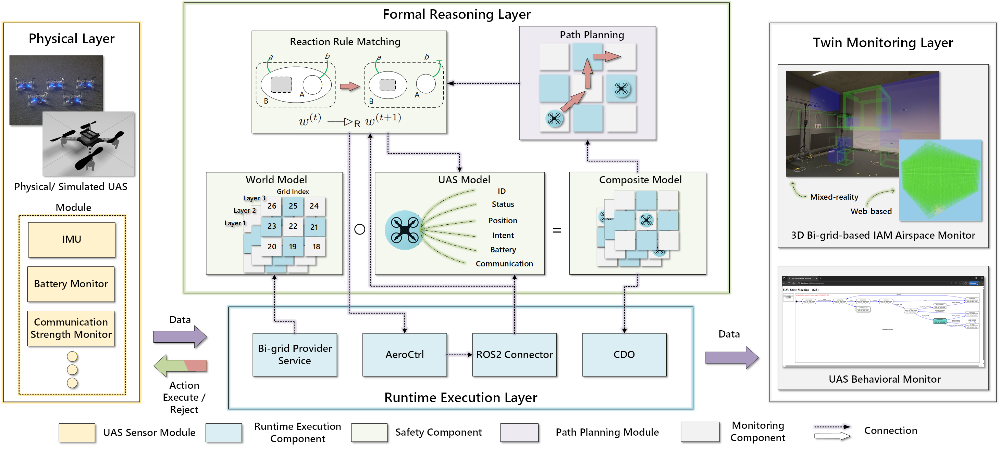
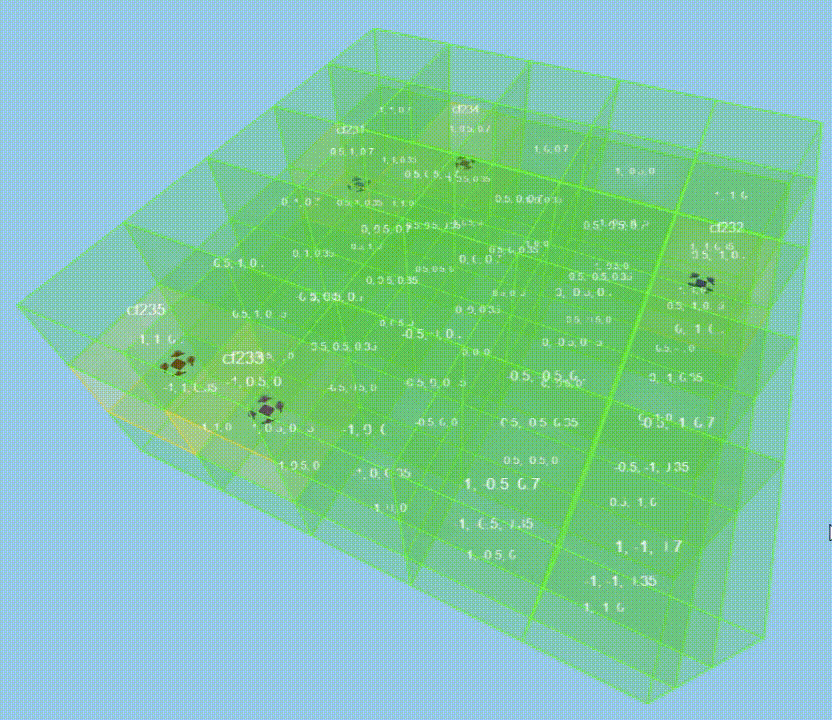
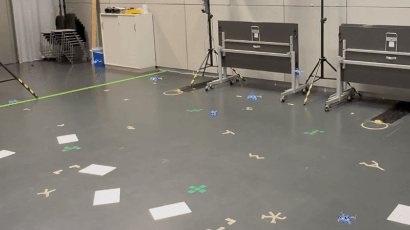

<h1 align="center">FEDT-Bigraph-UAS</h1>

[](https://shanecan.github.io/FEDT-Bigrid-UAS/)
[](https://www.youtube.com/watch?v=FBFthZUpgag)
[](LICENSE)
[](https://docs.ros.org/)
[](https://www.dcs.gla.ac.uk/~michele/bigrapher.html)
[](https://www.prismmodelchecker.org/)



*Formal Model-Based Executable Digital Twin (FEDT) framework architecture. The pipeline couples physical UAS execution, discrete bigraph-based reasoning, runtime validation, and monitoring in a closed loop.*

## Intro

This project demonstrates how Bigraphs can be used to model and control Crazyflie2.1 drones in simulation or reality. It implements a grid-based, collision-free UAV navigation system using Bigraphical Reactive Systems (BRS), ROS2, and time-expanded A* with Conflict-Based Search (CBS) for multi-UAS planning. This allows UAVs to fly safely from takeoff to landing in a discretized airspace while maintaining real-time digital twin consistency between the world model, UAV agent model, and live ROS2 data.

|                                                                                              |                                                                                        |
| -------------------------------------------------------------------------------------------- | -------------------------------------------------------------------------------------- |
|                          |                          |
| *Without FEDT*                                                                               | *With FEDT*                                                                            |
|  |  |
| *Digital twin — live grid occupancy and UAS state*                                           | *Physical layer — indoor Crazyflie testbed*                                            |

## Contributions

1. **A unified bigraph modelling method** for UAS flight operations in discretised 3D airspace, integrating airspace topology, occupancy, adjacency, mission phase, battery state, and communication state into a single executable runtime representation.
2. **A pre-execution verification and fail-safe mechanism** based on bigraph rewriting. Candidate movements and state transitions are executed only when their reaction-rule preconditions hold, enforcing grid occupancy exclusion and logical consistency before actuation.
3. **An end-to-end runtime assurance system** with ROS-based UAS execution, model synchronisation, and operator monitoring.

The framework is **planner-independent**: it acts as a runtime assurance layer that supervises the
outputs of existing planners or controllers, rather than serving as a trajectory generation or
formation control algorithm.

> Across nine scenarios and 1813 runtime-gate decisions, FEDT recorded **zero grid co-occupancy
> violations**. Full results are on the
> [project page](https://shanecan.github.io/FEDT-Bigrid-UAS/).

## Repository layout

| Path                                                               | Role                                                                                                                                     |
| ------------------------------------------------------------------ | ---------------------------------------------------------------------------------------------------------------------------------------- |
| [`bigrid-provider-service/`](bigrid-provider-service/)             | Spring Boot REST API that generates and serves the *bi-grid* — the bigraph world model with grid topology (Ecore XMI / JSON / Protobuf). |
| [`cps.asset.crazyflie/`](cps.asset.crazyflie/)                     | Self-contained Webots simulator, current Python HTTP control core, native ROSBridge and state diagrams.                                  |
| [`bigraphs.drone-collision-free/`](bigraphs.drone-collision-free/) | The FEDT runtime: joint bigraph world + UAS model, time-expanded A* + CBS planning, the runtime gate, and optional CDO model persistence. |
| [`bigrid/`](bigrid/)                                               | BigraphER + PRISM model checking of the reaction-rule set. See [`bigrid/README.md`](bigrid/README.md).                                   |

## Installation

Project code and the Webots asset live in this repository. For hardware, install
[Crazyswarm2 separately from upstream](cps.asset.crazyflie/README.md#hardware).

```bash
git clone https://github.com/ShaneCan/FEDT-Bigrid-UAS.git
cd FEDT-Bigrid-UAS
```

### Runtime requirements

The simulator container is pinned to **Ubuntu 22.04 / ROS 2 Humble / Webots R2025a**.
The host needs Docker Engine, Compose v2 and Python 3. A GUI requires X11 or WSLg;
headless operation uses a private virtual display. Host ROS is not required.

For the **full FEDT system**, also install **JDK 21**. Set `JAVA_HOME`
to the intended JDK if the host's default Java is older. The launchers do not
install or upgrade host Java, ROS or drivers. Maven is provided by each Java
module's wrapper.

### Build from source

From the repository root:

```bash
bash cps.asset.crazyflie/controller/cf.PyControl/bin/start_dssim_docker.sh --action build
(cd bigraphs.drone-collision-free && ./mvnw clean compile -DskipTests)
(cd bigrid-provider-service && ./mvnw clean package -DskipTests)
```

The first build downloads the pinned dependencies. World assets are bundled
locally.

## Usage

### Full FEDT system

Start each service in a separate terminal. Commands below use Linux/WSL; Java
can also run in a Windows IDE or with `mvnw.cmd`.

1. Start the backend: for Webots, run the simulator command below and wait for  `READY`; for hardware, follow the [hardware setup](cps.asset.crazyflie/README.md#hardware) to start the upstream radio/localization server, then `cf.PyControl`.
2. Start the grid provider for ordinary simulation or hardware:
   ```bash
     cd bigrid-provider-service
     ./mvnw spring-boot:run -Dspring-boot.run.arguments="--server.port=7070"
   ```
3. Run `org.example.Application` from `bigraphs.drone-collision-free` in your IDE, or use Maven with an explicit main class:

The same arguments go in the IDE's **Program arguments** field. Select one
profile as needed; profiles configure Java and do not switch the Webots world.

| Profile / Program arguments | Backend and dependencies |
| --- | --- |
| No active profile; arguments above | Ordinary Webots mission. Current Java defaults describe 12 UAS; match the selected world's IDs, targets and grid geometry. Requires the grid provider. |
| `--spring.profiles.active=drift` | Two-UAS wind experiment; manually select `crazyflie2.wbt`. Uses the Webots experiment service on 5090; no grid provider, CDO or ROSBridge needed. |
| `--spring.profiles.active=multievent` | Two-UAS wind/pause events; manually select `crazyflie2.wbt`. Same dependencies as `drift`. |
| `--spring.profiles.active=hardware` | External Crazyswarm2 + `cf.PyControl` + grid provider on 7070. Edit the five-UAS example fleet, targets and geometry in `application-hardware.properties` for your flight area. CDO and ROSBridge are disabled. |

CDO and ROSBridge are optional. To enable persistence, start CDO on 2036 from the
Java module with `./mvnw test -DrunDisabledTests=true -Dtest=CDOStandaloneServerTest#run_server_test_01`,
then use `--cdo.enabled=true` (optionally `--cdo.connection=cdo://HOST:2036/repo1`).
For ROSBridge observation, provide `/cf_positions_path` (`nav_msgs/Path`) on port
9090 and use `--ros.update.enabled=true --ros.bridge.host=HOST`. Otherwise keep
both flags false; HTTP control and controller ROS telemetry remain active.
Use Ctrl+C in each terminal to stop its service. The root all-in-one launcher
is no longer used.

### Simulator only

```bash
bash cps.asset.crazyflie/controller/cf.PyControl/bin/start_dssim_docker.sh
# Without a Webots window:
bash cps.asset.crazyflie/controller/cf.PyControl/bin/start_dssim_docker.sh --headless
```

This mode does not require Java, Maven, CDO or the grid service. You can run
your own HTTP/ROSBridge client, including a Java application on Windows, after
`READY`. Do not let two application clients command the same drones concurrently.

See the [standalone guide](cps.asset.crazyflie/README.md#world) for manual world
switching and backend setup. Profiles do not switch worlds automatically.

## Model checking

The reaction-rule set is verified independently of the running system. The bigraphical reactive
system is exported as a DTMC with **BigraphER** and checked with **PRISM**, confirming that no two
UAS ever occupy the same grid cell and that no landed UAS is left at an air locale.

- Install BigraphER via opam following the
[official instructions](https://www.dcs.gla.ac.uk/~michele/bigrapher.html#opam).
- Install [PRISM](https://www.prismmodelchecker.org/download.php).

```bash
cd bigrid
bash run_verified_analysis.sh        # exhaustive verification of the 2x2x2 configuration
bash verification_analysis.sh 2000   # bounded exploration of the 3x3x3 configuration
```

See [`bigrid/README.md`](bigrid/README.md) for the models, the properties that are checked, and the expected output.

## Citation

```bibtex
@article{zhang2026fedt,
  title  = {Runtime-Assured Digital Twins for Safe UAS Operations in Gridded Airspace},
  author = {Zhang, Tianxiong and Grzelak, Dominik and Victor, Victor and
            Sevegnani, Michele and Fricke, Hartmut and A{\ss}mann, Uwe},
  year   = {2026}
}
```

## License

Project code is released under the [MIT License](LICENSE). Bundled upstream runtime and world resources retain their own licenses and attribution.
